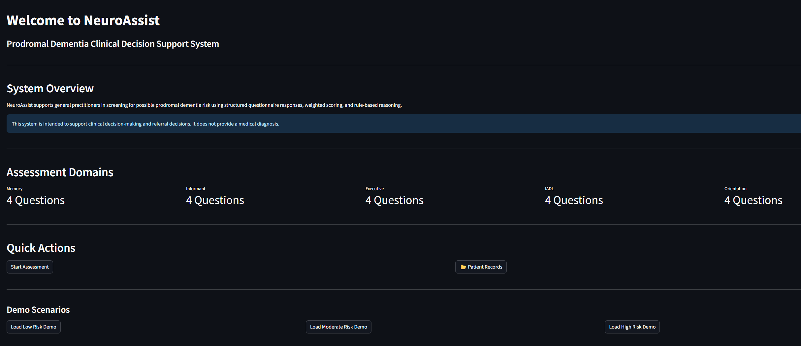
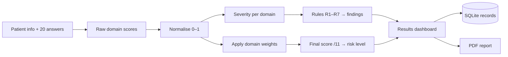
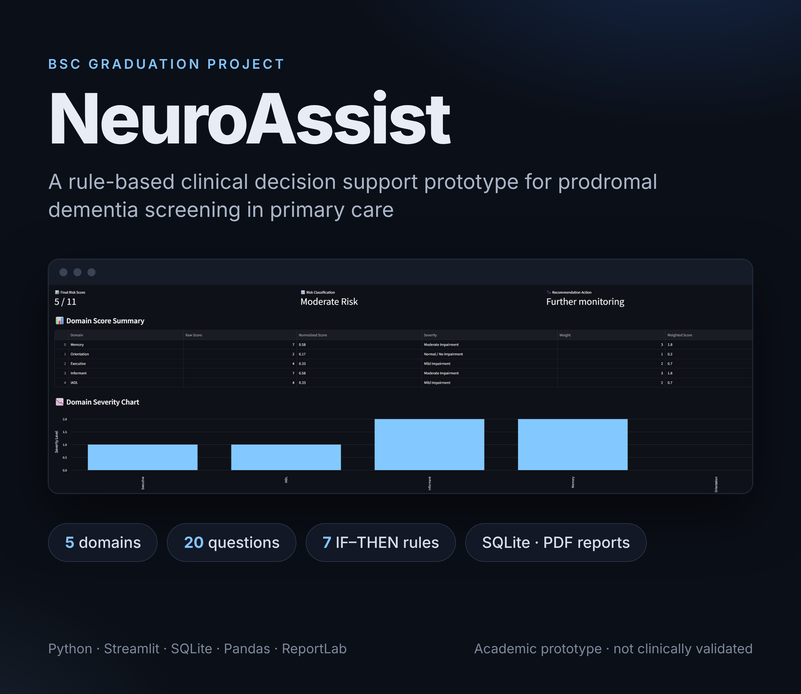
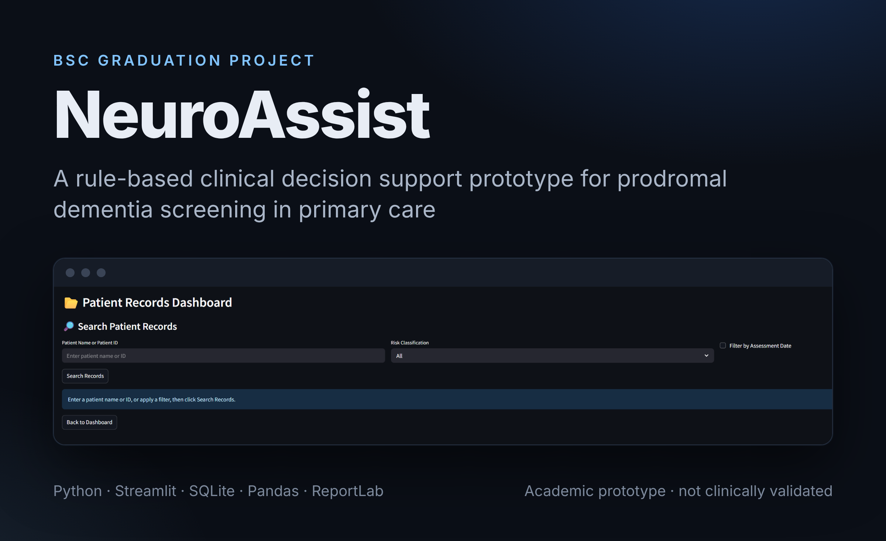

# NeuroAssist

**A rule-based clinical decision support prototype for prodromal dementia screening in primary care**

BSc graduation project · Canadian University Dubai · 2025–2026

> ⚠️ **Academic prototype — not clinically validated.** NeuroAssist was built for a university project. It does not diagnose dementia and must not be used for real clinical decisions or with real patient data.



## Overview

NeuroAssist helps a general practitioner run a structured screening for possible prodromal (early-stage) dementia risk. A 20-question assessment across five cognitive and functional domains feeds a transparent scoring and rule engine. That engine produces a risk level, the rules that fired, a recommendation and a downloadable PDF report.

We chose a rule-based approach over machine learning on purpose: every result can be traced back to specific answers, weights and rules.

## Features

- Patient and assessment information entry
- 20-question assessment across **5 domains**: Memory, Informant, Executive, IADL (instrumental activities of daily living) and Orientation
- Weighted scoring with per-domain normalisation and severity classification
- **7 IF–THEN rules** (R1–R7) that generate explainable clinical findings
- Low / Moderate / High risk classification with a suggested follow-up
- SQLite patient records with search and filters
- Assessment history, previous-vs-current comparison and risk trend chart
- Referral summary and **PDF report export** (ReportLab)
- Three built-in demo scenarios (Low, Moderate and High risk)

## How it works



**1. Scoring.** Each answer is scored 0–3 (Normal → Severe). Each domain has 4 questions, so its raw score is 0–12 and its normalised score is `raw / 12`.

| Normalised score | Severity |
|---|---|
| ≤ 0.25 | Normal / No impairment |
| ≤ 0.50 | Mild |
| ≤ 0.75 | Moderate |
| > 0.75 | Severe |

**2. Weighting.** Each normalised score is multiplied by its domain weight and the results are summed into a final score out of 11.

| Domain | Memory | Informant | Executive | IADL | Orientation |
|---|---|---|---|---|---|
| Weight | 3 | 3 | 2 | 2 | 1 |

**3. Risk classification.** A final score ≤ 3.0 is **Low**, 3.1–6.9 is **Moderate** and ≥ 7.0 is **High**.

**4. Rules.** These are evaluated over the domain severity levels. They explain the result but don't change the score.

| Rule | Fires when |
|---|---|
| R1 | Memory is Moderate or Severe |
| R2 | Informant concern is Moderate or Severe |
| R3 | Executive function is Moderate or Severe |
| R4 | Orientation is Moderate or Severe |
| R5 | IADL is Moderate or Severe |
| R6 | Memory **and** Informant are both Moderate or Severe |
| R7 | Memory, Informant **and** IADL are all Moderate or Severe |

## Screenshots

| Results dashboard | Patient records |
|---|---|
|  |  |

A sample PDF report generated from demo data is in [`sample_report.pdf`](sample_report.pdf).

## Getting started

Requires Python 3.10+ (developed on 3.13).

```bash
git clone https://github.com/leannejrodrigo/NeuroAssist.git
cd NeuroAssist
pip install -r requirements.txt
streamlit run app.py
```

The app opens in your browser. Click **Load Moderate Risk Demo** to see a full assessment without typing anything. Saved assessments go to a local `neuroassist_records.db` file, which git ignores.

## Project structure

```
app.py       Streamlit UI: pages, patient records, charts, PDF report
engine.py    Scoring, severity classification, rules R1–R7, risk classification
data.py      Knowledge base: questions, domain weights, answer scale
```

## Tech stack

Python · Streamlit · SQLite · Pandas · Matplotlib · ReportLab

## Limitations

- **Not clinically validated.** The questionnaire, weights and thresholds were designed by the project team from the literature, with feedback from a psychology professional. They are not a validated screening instrument such as the MoCA or MMSE.
- **Screening support only.** It does not diagnose and doesn't replace clinical judgement.
- **Informant availability isn't factored into scoring.** If no informant is available, that domain simply scores 0.
- **Static knowledge base.** Questions, weights and rules are hard-coded.
- **No security layer.** There's no login, encryption or access control, and records are stored in a local SQLite file. Do not deploy it with real patient data.
- **Testing was manual.** It covered 15 functional test cases (unit, integration and system). There's no automated test suite yet.

## Future work

- Clinical expert review and validation on real-world data
- More rules, plus an admin interface for editing the knowledge base
- Authentication, role-based access and encrypted storage
- EHR integration and an automated test suite

## Author

Designed and developed by **Leanne Jessica Rodrigo** ([@leannejrodrigo](https://github.com/leannejrodrigo)), covering software design, implementation, integration and testing.

Supervised by **Dr Firuz Kamalov**, Canadian University Dubai.

## License

[MIT](LICENSE)
